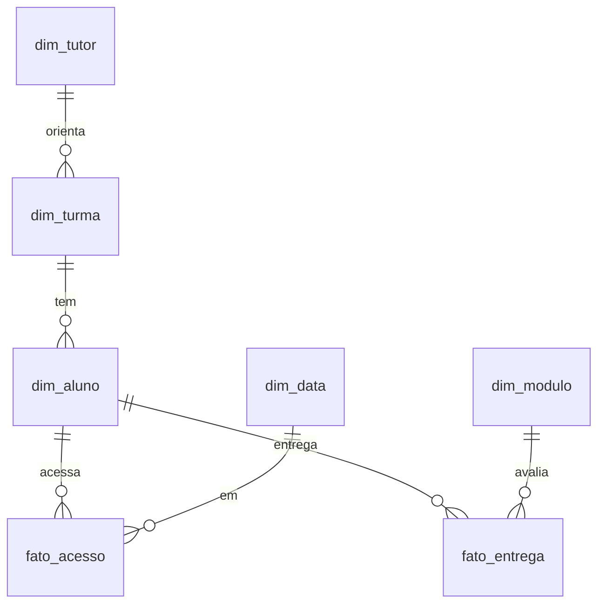

# Radar da Evasão · Learning analytics para EAD em Power BI

> **EN:** A Power BI report that flags, week by week, which students in an online course are at risk of dropping out, with row-level security so each tutor sees only their own classes. Built as a Power BI Project (PBIP) with the model in TMDL and the report in PBIR. Synthetic data generated in Python.

Painel que responde três perguntas de quem coordena um curso a distância: **quem está sumindo**, **em qual módulo o curso perde gente** e **qual tutor precisa de apoio**. Cada tutor enxerga só as próprias turmas (segurança por linha).

<!-- Coloque aqui um GIF de 10 a 20 segundos navegando no painel: docs/img/radar.gif -->

## Principais achados

Curso fictício de 10 semanas, 600 alunos, 12 turmas, 4 tutores. Situação na semana 7:

- **21% dos alunos já evadiram** (127 alunos sem acesso há 14 dias ou mais) e o funil cai de 574 entregas no módulo 1 para 384 no módulo 7.
- **O turno da noite perde quase o dobro da tarde**: 27,5% de evasão contra 16%.
- **As turmas de um tutor concentram o problema**: 30% de evasão, contra 16,7% no tutor com melhor resultado. É um sinal para apoio, não para punição: o painel mostra onde olhar.
- **Alunos que vêm de parceria com empresa evadem menos** (13,8%) do que pagantes (24,3%).
- **23 alunos estão em risco alto, mas ainda acessaram nos últimos 14 dias.** É o grupo com mais chance de ser recuperado com um contato nesta semana.

## Como abrir

1. Baixe ou clone o repositório.
2. Abra `RadarEvasao.pbip` no Power BI Desktop (versão de 2026 ou mais recente).
3. Clique em **Atualizar**. Os dados estão embutidos no modelo, então funciona sem internet e sem configurar nada.

Para testar a segurança por linha: **Modelagem > Exibir como > Outro usuário**, marque o papel **Tutor** e digite `diego.martins@radar-ead.exemplo`.

## Páginas

| Página | Para quem | O que mostra |
|---|---|---|
| Visão da Coordenação | Coordenação | Indicadores gerais, funil de permanência por módulo, evasão por turma e alunos ativos por semana |
| Alunos em Risco | Tutores | Lista de contato com score, dias sem acesso e entregas pendentes |
| Engajamento | Coordenação e design instrucional | Uso por tipo de recurso e evasão por perfil do aluno |

## O score de risco

Um modelo de machine learning acertaria um pouco mais, mas o tutor precisa entender **por que** um aluno está na lista para agir. Por isso o score é transparente:

```
Score = 100 × (0,45 × dias sem acesso + 0,35 × entregas atrasadas ou pendentes + 0,20 × queda de uso)
```

| Componente | Cálculo | Peso |
|---|---|---|
| Dias sem acesso | dias desde o último acesso ÷ 14, com teto em 1 | 45% |
| Entregas | atividades vencidas entregues com atraso ou não entregues ÷ atividades vencidas | 35% |
| Queda de uso | quanto o aluno usou a menos que a média da própria turma nos últimos 7 dias | 20% |

Faixas: **alto** a partir de 60, **médio** de 35 a 59, **baixo** abaixo de 35. Os pesos são hipóteses; com dados reais, o próximo passo seria calibrá-los comparando com quem de fato evadiu.

**Evasão** aqui é uma definição operacional: 14 dias ou mais sem acessar a plataforma.

## Modelo de dados



- Modelo em estrela com filtros em um único sentido.
- Todas as medidas ficam na tabela `Medidas`, organizadas em pastas e **com descrição**, o que também prepara o modelo para perguntas ao Copilot.
- O papel `Tutor` filtra `dim_tutor` pelo e-mail de quem está logado (`USERPRINCIPALNAME`), e o filtro desce por turma, aluno e fatos.

## Os dados

Os dados são **sintéticos** e gerados por `scripts/gerar_dados_radar.py`. Cada aluno recebe um perfil oculto de comportamento (engajado, esfria com o tempo, desiste depois de uma nota baixa, irregular, some cedo), influenciado por turno, forma de ingresso e tutor. **O perfil não vai para o Power BI**: o painel precisa descobrir os padrões pelos dados de acesso e entrega, como faria com uma base real.

Os CSVs gerados estão em `dados/` para consulta. Dentro do Power BI, eles estão embutidos no modelo para o projeto abrir sem depender de caminhos de pasta.

## Estrutura

```
RadarEvasao.pbip                    abre o projeto
RadarEvasao.SemanticModel/          modelo em TMDL (tabelas, medidas, relacionamentos, papel de RLS)
RadarEvasao.Report/                 relatório em PBIR (cada página e visual é um arquivo JSON)
scripts/gerar_dados_radar.py        gerador dos dados sintéticos
dados/                              CSVs gerados
```

## Decisões e limitações

- **Score explicável em vez de modelo preditivo**, pela razão acima.
- **Dados sintéticos** porque dados de alunos são sensíveis; o gerador está no repositório para quem quiser auditar ou mudar os parâmetros.
- **Data de referência fixa** na data do último acesso registrado, para o painel continuar fazendo sentido no futuro.
- Não há dado de contato com o aluno (e-mail, telefone) de propósito.

---
Feito com Power BI Desktop, DAX, Power Query e Python.
